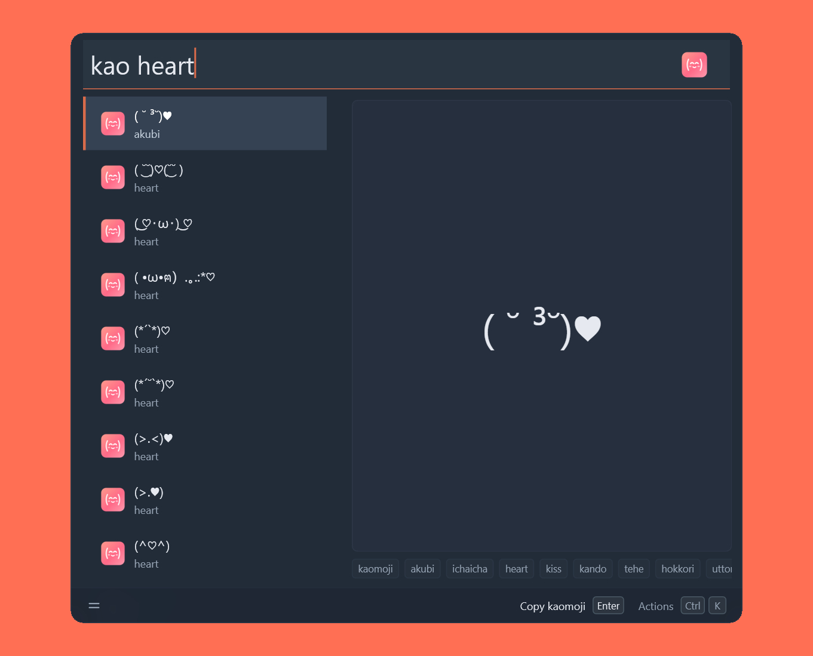

# Kaomoji

A [Wox](https://www.woxlauncher.com/) plugin for finding Japanese-style
text emoticons (kaomoji) in a bundled collection of more than 36,000 entries,
then copying the one you like as plain text or as a crisp PNG image, without
leaving the launcher.

## Features

- **Large offline catalogue** — 36,361 kaomoji and emoticons merged from two
  open-source datasets and covering 557 categories. No network access needed.
- **Field-aware search** — combine plain terms with `text:`, `tag:`, `cat:` and
  `src:` filters; every term must match.
- **Legible previews** — a large, centered webview preview that adapts its font
  size to the length of the kaomoji and follows the launcher's light or dark
  theme.
- **Copy or save** — copy the text, copy a themed PNG, or save a `.png` / `.txt`
  file to the desktop.
- **Recent picks** — previously used kaomoji are restored through Wox's MRU
  support, so favourites come back quickly.
- **Localized UI** — English, Simplified Chinese and Japanese, with
  per-character font fallback for kaomoji that mix kana, CJK, braille, symbols
  and emoji.
- **Cross-platform** — Windows, Linux and macOS on Wox 2.4.5 or newer.

## Screenshot



## Install

```shell
wpm install Kaomoji
```

## Usage

Type the trigger keyword `kao` in Wox to open the plugin. An empty query shows a
random sample of 60 kaomoji for browsing; as soon as you type, results are ranked
by relevance, up to 100 at a time. A full kaomoji can be pasted into the search
box, since its characters are valid search terms.

Press Enter to run the default action, or open the launcher's action panel to
choose another one:

| Action                    | What it does                                                    |
| ------------------------- | --------------------------------------------------------------- |
| Copy kaomoji (default)    | Copies the kaomoji text to the clipboard and hides the launcher |
| Copy as image             | Renders a themed PNG and copies that image to the clipboard     |
| Save PNG to desktop       | Saves the rendered PNG to the desktop                           |
| Save text file to desktop | Saves the kaomoji as a `.txt` file on the desktop               |

Saved files are named after the kaomoji itself (unsafe filename characters are
removed) plus a timestamp, and fall back to the home directory when no desktop
folder exists.

## Search syntax

Plain terms are combined with AND, so `love ^` finds kaomoji that mention
"love" and contain a caret. Each term can also be restricted to one field:

| Filter         | Matches                                  |
| -------------- | ---------------------------------------- |
| `text:^`       | kaomoji text                             |
| `tag:love`     | tags (`exact`, `prefix` and `substring`) |
| `cat:heart`    | category                                 |
| `src:emoticon` | source (`kaomoji` or `emoticon`)         |

Examples: `tag:love text:^`, `cat:cat text:^`, `src:emoticon`. Filters can be
mixed with plain terms and with each other; every term must match.

A query is lowercased and split on whitespace, including the ideographic space
produced by CJK input methods. Duplicate terms are dropped and a query is capped
at 8 terms, so one keystroke never turns into an unbounded scan. Results are
ranked by match quality — exact text, text prefix, exact category, name or
description, category substring, tag match, and text substring, in that order of
preference — with shorter kaomoji winning ties.

## Preview and images

The preview panel renders each kaomoji in a webview rather than in the result
row, so kana, wide symbols and combining marks stay readable. The font size is
fitted to the widest line (from 14 px to 48 px), long kaomoji wrap instead of
being clipped, and `pre-wrap` keeps the spaces that are part of the kaomoji.
Source, category, tags and description are shown as tags below the preview.

Copying and saving use the same font stack, font size, padding, line height and
theme colours as the preview, at 2x scale so PNGs stay sharp on HiDPI displays.
Fonts are resolved per platform: Windows system fonts (including TrueType
collections such as Microsoft YaHei and MS Gothic), Linux fonts via fontconfig,
and macOS system fonts, with a per-character fallback chain so characters from
mixed scripts are drawn with a face that actually covers them.

## Data

The dataset in `src/data.json` is generated by `scripts/generate-data.mjs` from
two MIT-licensed projects:

- [`kaomoji-collection`](https://github.com/kaomojiya-collection/kaomoji-collection)
  — 36,070 entries across its categories, which become tags.
- [`emoticon`](https://github.com/wooorm/emoticon) — 322 emoticons with names,
  descriptions, tags and emoji.

HTML character references are decoded, texts are deduplicated into a single
record per kaomoji, and the categories, tags, names and descriptions of both
sources are merged. The result is 36,361 unique entries, 31 of them present in
both sources. Full licence texts are in
[`THIRD_PARTY_NOTICES.md`](THIRD_PARTY_NOTICES.md).

## Development

Requirements: Node.js, [pnpm](https://pnpm.io), `make`, and Python 3 (used by the
project initialisation check). `make package` uses `Compress-Archive` on Windows
and the `zip` command elsewhere, so Linux and macOS need `zip` installed.

| Command        | Description                                                        |
| -------------- | ------------------------------------------------------------------ |
| `make install` | Install dependencies with pnpm                                     |
| `make data`    | Regenerate `src/data.json` from the installed datasets             |
| `make build`   | Regenerate data, lint, format, bundle to `dist/` and copy assets   |
| `make dev`     | Watch sources and rebuild through nodemon                          |
| `make test`    | Run the Jest test suite                                            |
| `make lint`    | Run ESLint over `src/`                                             |
| `make format`  | Format sources, JSON and this README with Prettier                 |
| `make package` | Build and produce a distributable `wox.plugin.kaomoji.wox` archive |

Bundling uses `@vercel/ncc` followed by Babel; `dist/` is what gets packaged and
loaded by Wox.

## Project layout

| Path                        | Purpose                                                           |
| --------------------------- | ----------------------------------------------------------------- |
| `src/index.ts`              | Plugin entry point: queries, results, actions and MRU restore     |
| `src/lib.ts`                | Search index, query parser, scoring and browse sampling           |
| `src/preview.ts`            | Webview preview HTML, theming and font sizing                     |
| `src/image.ts`              | PNG rendering, font resolution and font collection handling       |
| `src/data.json`             | Generated dataset bundled with the plugin                         |
| `scripts/generate-data.mjs` | Data pipeline that merges and normalises the upstream datasets    |
| `plugin.json`               | Wox manifest: trigger keyword, i18n strings, icon and MRU feature |
| `Makefile`                  | Install, data, build, test, lint, format and packaging tasks      |

## License

Released under the [MIT License](LICENSE). The bundled datasets come from two
MIT-licensed projects; their notices are reproduced in
[`THIRD_PARTY_NOTICES.md`](THIRD_PARTY_NOTICES.md).
